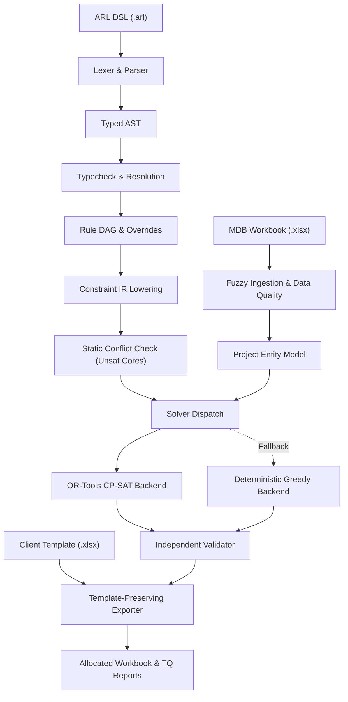

# Allocation Rule Language (ARL) v2

[](https://www.python.org/downloads/)
[](https://opensource.org/licenses/MIT)

**Allocation Rule Language (ARL) v2** is a declarative, statically typed, extensible domain-specific language and execution engine purpose-built for industrial I/O signal allocation in Emerson DeltaV Distributed Control Systems (DCS).

ARL replaces error-prone spreadsheet macros and manual engineering workflows with a provably sound, verifiable compiler and multi-backend constraint solver pipeline.

---

## 1. System Architecture

ARL executes an 11-phase zero-exception pipeline:
```
parse → typecheck → resolve → normalize → dag_build → override_apply → lower → conflict_check → solve → validate → report
```



---

## 2. Core Capabilities

- **Strict Schema-Driven Modeling:** Domain entities (`Signal`, `Charm`, `Baseplate`, `CIOC`, `Cabinet`, `Cable`, `Pair`, `Group`) and reference types are defined declaratively in `schema.yaml`. Dynamic extensions require zero code changes.
- **Hindley-Milner Type System:** Strong static checking with explicit coercions (`Tag` $\to$ `String`, `as Slot`), optional unwrapping (`is some x`), and aggregate safety.
- **Rule DAG & Override Inheritance:** Deterministic topological sorting with cycle detection (`E2009`), include cycles (`E3004`), and safe priority overrides.
- **Static Conflict & Unsat Core Detection:** Detects mutually exclusive slot intervals and contradictory hard assignments (`E3001`, `E3002`) prior to solver dispatch.
- **Dual Solver Backends:** High-performance OR-Tools CP-SAT solver with automated fallback to a deterministic Greedy allocator when models time out (`E5001`).
- **Independent Validation:** Post-solve independent auditor strictly verifies hardware bounds, slot overlaps, and hard rule compliance before any export.
- **Excel Ingestion & Template Preservation:** Fuzzy column mapping, robust data quality error detection (`E4001`–`E4010`), and byte-exact template formatting retention.
- **Revision & Move Minimization:** Rev A $\to$ Rev B diff analysis with 5-tier pin relaxation priority order and move budget enforcement (`E6003`).
- **Natural-Language Bridge:** Controlled AI rule assistant with multi-stage compiler guardrails, offline heuristic fallback, and mandatory human confirmation.
- **CLI & Streamlit UI:** Complete CLI toolset with exit code precedence, paired with an interactive 6-tab Streamlit engineering console.
- **Rule Lifecycle Governance:** Semantic versioning (`MAJOR.MINOR.PATCH`) with strict immutability for published rulesets.

---

## 3. Installation & Setup

ARL requires Python 3.11+.

```bash
# Clone repository
git clone https://github.com/example/codeapex.git
cd codeapex

# Create virtual environment and activate
python3 -m venv .venv
source .venv/bin/activate

# Install dependencies and package
pip install -e .
```

### Windows (PowerShell)

Use a separate environment rather than reusing a `.venv` created on macOS or Linux:

```powershell
py -3.11 -m venv .venv-win
.\.venv-win\Scripts\Activate.ps1
python -m pip install -e .
python -m streamlit run .\arl\ui.py
```

---

## 4. CLI Usage

The `arl` command provides full access to compilation, checking, allocation, and revision:

```bash
# 1. Compile and typecheck an ARL ruleset
arl compile ruleset.arl

# 2. Dry-run check ruleset against MDB data
arl check ruleset.arl --data mdb.xlsx

# 3. Allocate signals into hardware carriers
arl allocate ruleset.arl --mdb mdb.xlsx --template template.xlsx --out allocated.xlsx

# 4. Revise allocation from Rev A to Rev B with minimal moves
arl revise ruleset.arl --revA rev_a_alloc.xlsx --revB rev_b_mdb.xlsx --out rev_b_alloc.xlsx

# 5. Diff two ARL ruleset files
arl diff-rules a.arl b.arl

# 6. Diff two allocation workbooks
arl diff-alloc a.xlsx b.xlsx

# 7. List registered predicates
arl predicates list

# 8. Register custom predicates from YAML
arl predicates register custom_predicates.yaml
```

### Numerical Exit Codes & Precedence
- `0`: Success (complete allocation, zero unplaced signals)
- `1`: Compile error (`E1xxx`, `E2xxx`, `E3xxx`)
- `2`: Data error (`E4xxx`)
- `3`: Solver fallback (`E5xxx`, `E6xxx`, degraded mode)
- `4`: Internal error

When multiple errors occur:
$$\text{Internal (4)} > \text{Compile (1)} > \text{Data (2)} > \text{Solver Fallback (3)} > \text{Success (0)}$$

---

## 5. Streamlit Web Interface

Launch the interactive engineering console:

```bash
streamlit run arl/ui.py
```

The web application provides 6 integrated tabs:
- **Upload:** Inspect Excel MDB tables and adjust fuzzy column mappings.
- **Rules:** Interactive DSL code editor and visual Form Rule Builder with live compiler checks and dry-run impact previews.
- **Allocate:** Run allocations with CP-SAT or Greedy backends, configure timeouts, and view progress.
- **Reports:** Analyze hardware slot utilization, spare percentages, and quarantined rules.
- **TQs:** Filter and resolve engineering Technical Queries.
- **Revision:** Compare Rev A vs Rev B allocations, inspect pinned signals, and audit moved channels.

---

## 6. Sample Ruleset Walkthrough

A sample ruleset is provided in [`samples/sample_ruleset.arl`](file:///Users/kasturirasekar/Desktop/codeapex/samples/sample_ruleset.arl):

```arl
ruleset DeltaVStandardRules {
    rule R_Slot_Bounds:
        scope: Charm
        require slot >= 1 and slot <= 12
        priority: hard
        id: R001
        message: "Slot index must be within baseplate bounds 1..12"

    rule R_Prefer_Contiguity:
        scope: Group
        prefer contiguous(self.signals, "asc")
        priority: soft
        weight: 10.0
        id: R002

    rule R_Assign_Standard_TB:
        scope: Charm
        when: self.signal != null
        assign tb_type = "STANDARD"
        priority: hard
        id: R003

    objective Optimize_Spare_Capacity:
        primary: [spare_percent(self)]
        secondary: [used_slots(self)]
        weights: { spare_percent: 100.0, used_slots: 50.0 }
}
```

Run the complete pipeline against the included sample dataset:

```bash
arl allocate samples/sample_ruleset.arl \
  --mdb samples/sample_mdb.xlsx \
  --template samples/sample_template.xlsx \
  --out allocated_output.xlsx
```

---

## 7. Testing & Verification

ARL includes comprehensive unit, integration, and property-based tests across all compiler stages:

```bash
# Run complete test suite
pytest -v
```

See [`ARCHITECTURE.md`](file:///Users/kasturirasekar/Desktop/codeapex/ARCHITECTURE.md) for full design specifications and [`ERRORS.md`](file:///Users/kasturirasekar/Desktop/codeapex/ERRORS.md) for the complete error code catalog.
